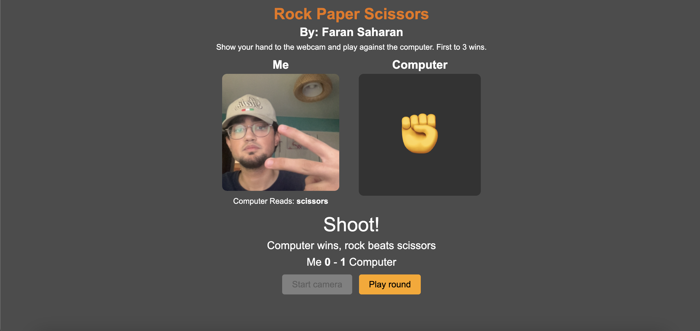
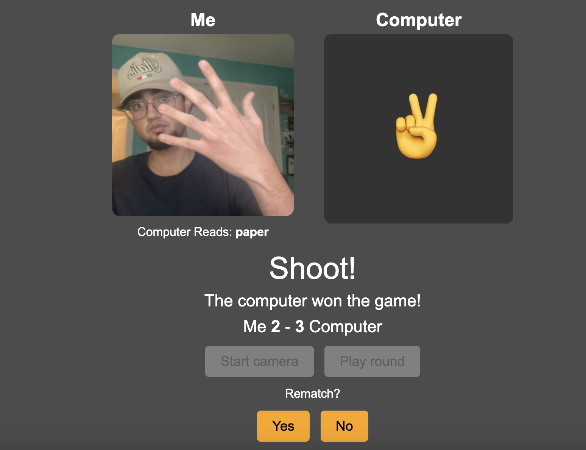
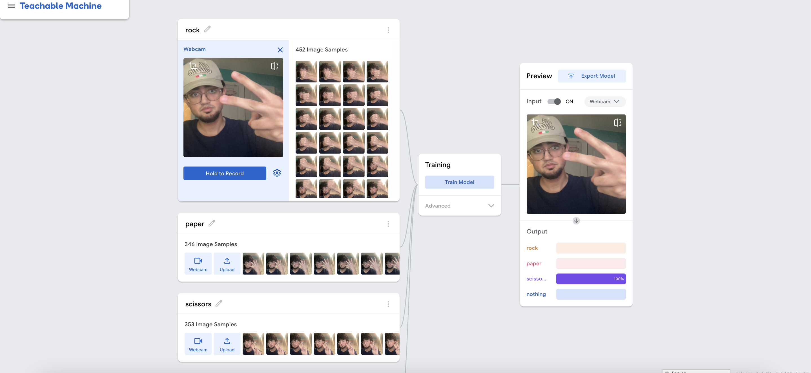
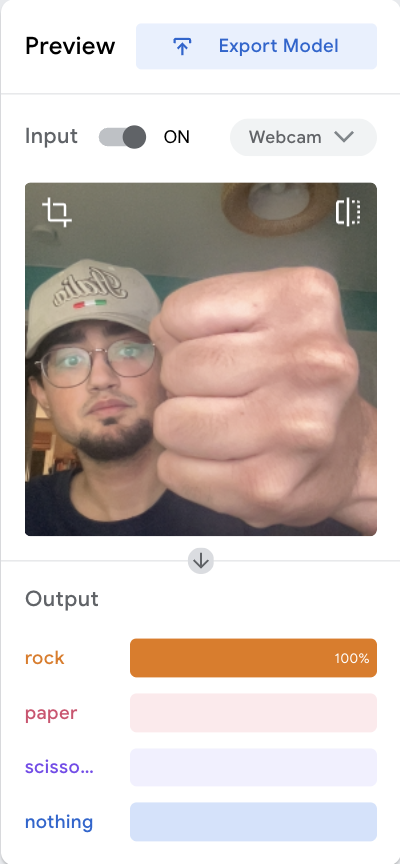
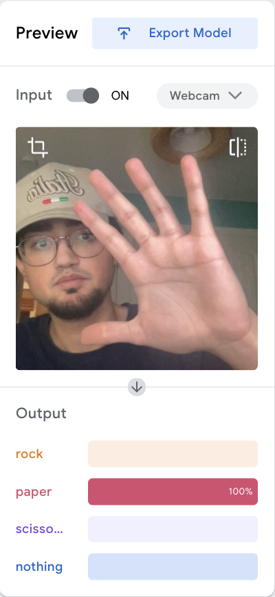
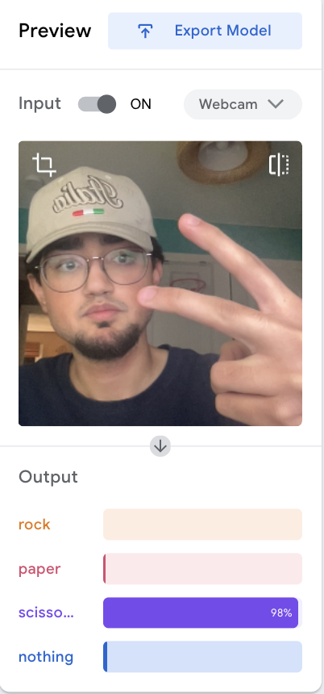
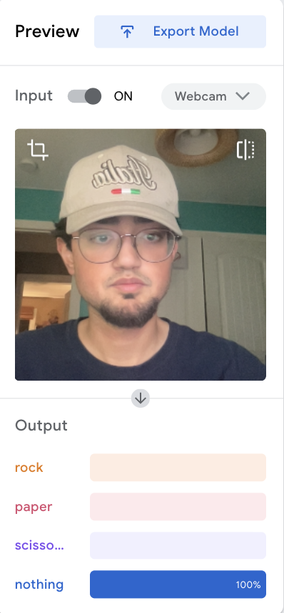

# Rock Paper Scissors vs AI

Play rock paper scissors against the computer using your webcam. Show your hand, the AI figures out if it's rock, paper or scissors, and the computer picks randomly. First to 3 wins.

## How it works

I trained an image model with Google's Teachable Machine using 4 classes: rock, paper, scissors and nothing. The "nothing" class is so it doesn't guess a hand when there isn't one.

I took 350+ webcam photos for each class (around 1,400 total). I moved my hand around while recording: closer and further from the camera, different angles, left and right side of the frame. That way the model learns the hand shape and not just one position.

After training, I tested each class in Teachable Machine's preview before exporting:

<table>
  <tr>
    <td align="center"> Rock</td>
    <td align="center"> Paper</td>
  </tr>
  <tr>
    <td align="center"> Scissors</td>
    <td align="center"> Nothing</td>
  </tr>
</table>

The game runs the model on every webcam frame. It only counts a guess if the model is more than 60% sure. When you hit "Play round" there's a 3-2-1 countdown, and whatever it sees at "Shoot!" is your move.

## Built with

- HTML, CSS, JavaScript
- Teachable Machine + TensorFlow.js

## Problems I ran into

- The model kept showing NaN for its predictions. It turned out the newest versions of the libraries didn't work with my exported model, so I had to use older versions.
- At first the model only ever guessed "rock". Retraining with more photos at different angles and distances fixed it.
- The page needs to run on a local server (I used Live Server in VS Code). Opening the HTML file directly doesn't allow camera access.